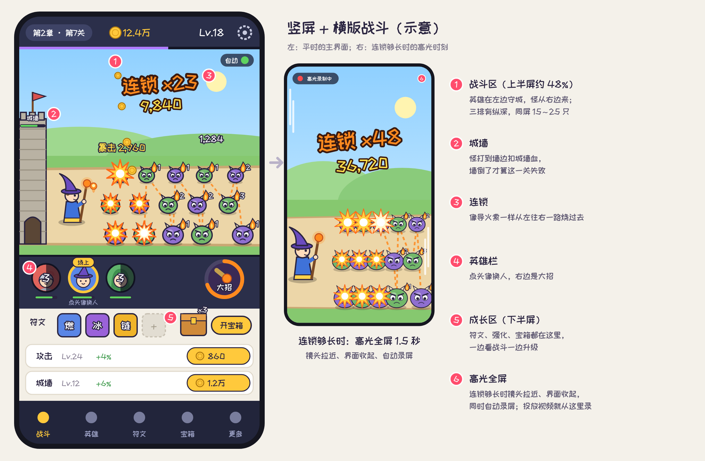

# 《Game Fight》游戏设计文档（GDD）v0.2

> 暂定名 · 抖音小游戏 · 竖屏 + 横版守城 · 连锁引爆 · 纯广告变现、投流回本
> v0.1 写于 2026-11-22；v0.2 同日修订，依据是 [市场调研与差异化.md](市场调研与差异化.md)。
> 所有数值都是**初版占位**，开发时写进配置表，用数值模拟器和投流数据调。

---

## v0.2 改动摘要

| # | 改了什么 | 为什么 |
|---|---|---|
| 1 | **画面**：竖向通道 → **竖屏 + 横版守城**。英雄在左边守城，怪从右边来；上半屏战斗，下半屏常驻成长区 | 成长和奖励界面能一直摆在屏幕上；每个英雄只要 1 张图；同类挂机游戏多是这种布局（调研第 8 节） |
| 2 | **卖点**：三人接力 → **连锁引爆**。换人保留，作为引爆的触发方式 | 换人海外已有且不温不火，在 3 秒视频里也看不出来；连锁是一眼能看懂的画面 |
| 3 | **引爆**：同时炸 → **多米诺连锁**，三种印记三种传导方式；加入"憋"的决策 | 招牌时刻要持续 1～2 秒、越来越响；怪越挤连锁越长，但会打城墙，玩家要在贪和稳之间选 |
| 4 | 新增**符文宝箱** | 补上奖励循环，同时是最自然的广告位 |
| 5 | **商业模式**：投流买量，靠广告收入回本；不依赖运营 | 你的决定；回本模型和过关线见调研第 7 节 |
| 6 | 失败规则："不卡关" → **"不卡死"** | 卡点处的激励视频就是收入；但只挂机也一定能慢慢推过去 |
| 7 | 关卡、每日挑战、Boss 轮换**全部按规则自动生成** | 上线后不需要人往里加内容 |
| 8 | 新增**高光全屏**和**录素材模式** | 投放视频直接从真实游戏里录，还能用脚本批量录 |
| 9 | 运营降为**备用手段**，现在先留接口 | 投流数据差一点时再启用（调研 7.3） |
| 10 | 题材：A 西幻 / B 萌宠 / C 打工人，**投流测完再定** | 玩法和题材分开，换题材只换图和配置 |

---

## 目录

1. 概述
2. 表现形式
3. 特色
4. 战斗系统
5. 英雄（MVP 3 个）
6. 成长系统
7. 关卡与内容（全部自动生成）
8. 挂机与离线
9. 经济、节奏与回本指标
10. 新手引导（前 10 分钟）
11. 广告
12. 高光录屏、分享与录素材模式
13. 投放与回本
14. 技术方案
15. 美术需求
16. MVP 范围与开发顺序
17. 备用运营接口
18. 待定

---

## 1. 概述

| 项 | 内容 |
|---|---|
| 一句话 | 怪从右边成群冲向城墙，英雄在城前自动开打。等怪挤满城下，点一下换人，印记像导火索一样一路连锁，炸穿全场。 |
| 平台 | 抖音小游戏（先），微信小游戏（以后） |
| 屏幕 | 竖屏 750×1334 设计稿，单手操作 |
| 单次时长 | 打开一次 2～5 分钟；一关 30～45 秒 |
| 目标用户 | 抖音泛休闲用户（18～40 岁为主，男女比例均衡），不只是割草核心玩家 |
| 变现 | 激励视频为主；插屏开不开看数据；不做内购 |
| 商业模式 | 投流买量，靠广告收入回本（第 13 节） |
| 三个卖点 | ① **连锁引爆**：多米诺式一路炸穿全场 ② **连锁纪录 + 每日挑战**：一个想晒的数字 ③ **符文宝箱**：连锁越长，宝箱越好，符文改变连锁规则 |

**设计原则：**
- **打开就在打。** 没有开场剧情、没有选角色。
- **一切为招牌时刻服务。** 设计都是为了让连锁引爆更大、出现得更多、更好录成视频。
- **玩家只需要主动做一件事：换人**，也就是决定什么时候引爆。其他全自动。
- **不卡死。** 只挂机也一定能慢慢推过每一关，看广告只是更快。
- **上线后不需要人往里加内容。** 关卡、每日挑战、Boss 轮换都按规则自动生成。
- **每个广告位都是"占便宜"。**

---

## 2. 表现形式

### 2.1 竖屏 + 横版战斗



左边是平时的主界面，右边是连锁够长时的高光全屏。竖向通道的方案（[main-screen.png](images/main-screen.png)）保留为对照组：第一轮素材测试用同一个题材、两种方向各录几条视频，用买量成本选（调研第 8 节）。战斗逻辑不关心画面方向，原型两种都支持。

### 2.2 主界面布局

| 区域 | 占屏高度 | 内容 |
|---|---|---|
| 顶栏 | 约 8% | 关卡、金币、队伍等级、设置；下沿一条经验条 |
| 战斗区 | 约 48% | 城墙在最左，英雄站在城前，怪从右边分三排进场；右上角是「自动」开关 |
| 英雄栏 | 约 13% | 3 个头像：场上的有金边，待命的显示换人冷却；印记够多时待命头像发光；右边是大招按钮 |
| 成长区 | 约 21% | 符文槽、宝箱、强化（攻击、城墙……），一边看战斗一边升级 |
| 底部导航 | 约 10% | 战斗 / 英雄 / 符文 / 宝箱 / 更多 |

### 2.3 战斗区里在发生什么

1. 怪从右边分三排进场，往左走向城墙；走到城墙前停下来打墙。
2. 英雄自动攻击，攻击会给怪叠上这个英雄的**印记**。
3. 玩家点待命英雄的头像换人。换上来的英雄放**入场技**，从离城墙最近的带印记的怪开始**连锁引爆**（第 4.4 节）。
4. **一关 = 5 波**，最后一波有精英。打完自动进下一关；每章第 10 关是 Boss 关，需要玩家点「挑战」（第 4.6 节）。
5. 怪被打死：闪白 → 横着飞出去或碎开 → 掉金币，金币飞进顶栏。

### 2.4 高光全屏

- 连锁达到 **15 跳**时触发：镜头拉近到连锁区域，英雄栏、成长区、导航收起，屏幕上只剩战斗和大号连锁计数。
- 连锁结束后停 0.5 秒，镜头拉回，界面滑回来。
- 同时自动录屏：保留触发前 3 秒和整个高光，结算页可以一键发抖音（第 12 节）。
- 投放视频也从这里录，所以**广告里的画面就是真实的游戏画面**。

### 2.5 美术：单张图 + 程序动画

角色和怪都只画**单张侧身图**（用 ChatGPT 出图就能做），动作全部由程序做：

| 动作 | 程序做法 |
|---|---|
| 待机 | 上下轻微起伏 |
| 走路 | 左右轻摇 + 小跳 |
| 攻击 | 往前一冲再弹回，程序画武器拖影 |
| 受击 | 闪白 + 往后弹 + 挤压变形 |
| 死亡 | 压扁 → 横着飞出去或碎成几块 → 淡出 |
| 入场技 | 英雄从城墙上跳下来，落地冲击波 |
| 大招 | 英雄立绘从侧面滑入 0.6 秒，然后全屏特效 |

**打击感清单（原型必须做到）：** 飘字（白 = 普通，黄 = 暴击，橙色特大 = 连锁）、顿帧、震屏、金币飞进顶栏、连锁计数每跳放大一次、每跳音调升高一级。

**性能：** 同屏怪物上限 40 只；怪、飘字、金币、粒子全部用对象池；低端安卓自动减少粒子。

---

## 3. 特色

### 3.1 定位

**能挂机的守城割草 + 一键连锁引爆。** 战斗像割草一样怪多、炸得爽；成长像挂机一样一直在累积；玩家唯一要做的决定是"什么时候引爆"。

### 3.2 招牌时刻：连锁引爆

满屏带印记的怪挤在城下 → 点一下换人 → 连锁像导火索一样从左往右一路烧过去，计数 ×1、×2……×48，每跳音调升高、数字放大 → 高光全屏 → 金币雨 + 宝箱。

**3 秒投放视频就拍这一段。**

### 3.3 奖励循环：符文宝箱

连锁越长，掉的宝箱越好；宝箱开出**符文**，符文改变连锁的规则（第 6.3 节）。想开到好箱子，就去打更长的连锁；拿到新符文，就想试试能不能连得更长。

### 3.4 不用运营也能长线

关卡按公式无限生成，每日挑战按日期自动生成，Boss 自动轮换，再加上转生和离线收益。上线后不需要人往里加内容，留存靠成长本身拉长。

### 3.5 不做什么

- 不做抽卡：英雄按关卡解锁。
- 不做装备：符文就是唯一的"掉落"。
- 不做剧情：每章开头最多一句话。
- 不做联网对战。
- 不做每局重来的肉鸽：成长持续累积。

---

## 4. 战斗系统

### 4.1 基本规则

- **通道坐标**：从城墙往右，0（城墙）～1000（怪出生处）；分 3 排，排与排之间算 60 的距离。
- 英雄站在城前（约 60 处），不会被打；怪只打城墙。
- 属性只有四个：**攻击、攻速、暴击率**（暴击 ×2）、**城墙生命**。
- 战斗逻辑以固定步长运行（每秒 30 次），和画面分开，方便单测、模拟、录素材。

### 4.2 换人

| 规则 | 初版数值 |
|---|---|
| 点待命英雄的头像就换人 | — |
| 换人冷却（全队共用） | 5 秒 |
| 换上来的英雄立即放入场技，开始连锁 | 入场技不占技能冷却 |
| 待命头像发光提示 | 场上"能被这个英雄引爆的印记" ≥ 12 层 |

**自动换人（挂机）：** 每 9 秒按顺序换一次，不看印记，所以手动看准时机换的连锁会更长。第 2 章 Boss 之后解锁「智能换人」（印记够了才换）。

### 4.3 印记

- 每个英雄的攻击会给怪叠**自己的印记**。每只怪每种印记最多 5 层，8 秒不叠就消失。
- 一只怪身上可以同时有几种印记。

| 印记 | 谁挂的 | 印记本身的效果 | 被引爆时怎么传 |
|---|---|---|---|
| 燃烧 | 法师 | 每层每秒掉一点血 | **圆形扩散**：点燃周围一圈带印记的怪；层数越多圈越大 |
| 冰霜 | 射手 | 每层减速 10%，叠满 5 层冻住 1.5 秒 | **冰锥直线传**：沿同一排往前、往后各射一根冰锥，点燃远处最近的带印记的怪 |
| 破甲 | 剑士 | 每层让这只怪受到的伤害 +4% | **往里吸**：先把周围的怪往它身上吸一段，再小范围点燃 |

### 4.4 连锁规则

1. **起点**：换上来的英雄，从**离城墙最近的、带"别人的印记"的怪**开始引爆。自己的印记不会被自己引爆，所以要轮换。
2. **一次只炸一只**，排队往下传。间隔从 70 毫秒开始，越往后越快，最快 25 毫秒，听起来像越烧越快的导火索。
3. 炸开时，按它身上的印记决定能点燃谁（第 4.3 节表）。几种印记叠在一起时效果合并：圈更大、能射冰锥、还会往里吸。
4. **只有带印记的怪会被点燃、继续往下传**；没印记的怪只挨炸，不传。
5. **伤害**：每一跳的伤害 = 基础伤害 × 印记层数系数 × (1 + 10% × 第几跳)，越往后越疼。爆炸会伤到范围内所有的怪。
6. **表现**：顿帧 80 毫秒开场 → 计数 ×1、×2……每跳放大一次 → 每跳音调升高一级 → 15 跳触发高光全屏 → 结束时金币雨 + 宝箱。

**"憋"：** 怪越挤、印记越多，连锁越长。但怪挤在城下就会打城墙。是让它们再多挤一会儿打出大连锁，还是现在就炸？挂机时 AI 按固定节奏炸，手动玩家去憋大的。

### 4.5 大招（M1）

全队共用一条能量，打中怪和连锁都加能量；满了点按钮，放当前场上英雄的大招。自动模式下能量满了自动放。

### 4.6 城墙、失败与 Boss

- **普通关**：城墙被打穿 → 退回上一关继续挂机，不扣任何东西，顶部提示"差一点！升级后再来"。挂机攒够了自动再推。
- **Boss 关**（每章第 10 关）：不会自动开打，战斗区右上出现「挑战 Boss」。Boss 战限时 30 秒，超时或城墙被打穿算失败，回去继续挂机。
- 失败弹窗三个选项：**看视频复活**（城墙满血，接着打）/ **去升级** / **继续挂机**。
- **不卡死**：数值模拟器检查"只挂机、不看广告"也能在合理时间内推过每一关（第 9 节）。

---

## 5. 英雄（MVP 3 个）

| 项 | 剑士（开局就有） | 法师（新手引导第 20 秒加入） | 射手（第 5 关通关加入） |
|---|---|---|---|
| 普攻 | 横斩城前一片，三排都打（近战） | 火球打最近的怪，小范围溅射 | 快速射箭，沿一排穿透前 2 只 |
| 印记 | 破甲 | 燃烧 | 冰霜 |
| 入场技 | **落地斩**：从城墙跳下，震退城前的怪，引爆 | **爆炎**：引爆，再朝怪最密处扔一个大火球 | **贯穿箭**：一箭打穿一整排，引爆 |
| 技能（M1） | 旋风斩：打身边一圈 | 炎墙：横在通道上，穿过的怪叠燃烧 | 多重箭：三排各射一支穿透箭 |
| 大招（M1） | 剑气风暴：三道剑气横扫三排 | 陨石：砸最密的地方 | 箭雨：全场 3 秒 |
| 定位 | 让怪挤在一起（破甲往里吸） | 让连锁扩散（燃烧扩圈） | 让连锁跳远（冰锥直线） |

**后续英雄（1.0 起按章节解锁）**：雷法师（感电：连锁时额外跳一只最远的）、召唤师（灵魂：被炸死的怪变成我方小兵）、毒师（剧毒：被引爆时传染）、炮手（标靶：被引爆时追加一轮炮击）……每个都带一种新的传导方式。

---

## 6. 成长系统

| 资源 | 怎么来 | 用来干什么 |
|---|---|---|
| 经验 | 打怪掉 | 队伍自动升级 |
| 金币 | 打怪、连锁、宝箱 | 强化 |
| 宝箱 | 连锁达到门槛掉落 | 开出符文 |
| 技能点 | 每 5 级给 1 点 | 升级入场技和技能 |

### 6.1 队伍等级

全队共用一个等级，每升 1 级全队攻击 +3%。前 10 分钟大约每 30～60 秒升一级，每次升级全屏金光 +「叮」。

### 6.2 金币强化

攻击、城墙生命、攻速、暴击率、金币加成（有上限）。每级价格 ×1.07。成长区有「一键升级」：按性价比自动花金币。

### 6.3 符文

- **掉落**：一次连锁 ≥ 15 跳掉木宝箱，≥ 30 掉银宝箱，≥ 60 掉金宝箱。宝箱从战斗区弹出来，按品质发不同颜色的光，飞进成长区。
- **品质**：白、蓝、紫、金。重复的符文自动合成升级。
- **符文槽**：开局 3 个，第 3 章、第 6 章各开一个，最多 5 个。
- **符文改变连锁的规则**，而不只是加数值。示例：
  - 燃烧爆炸半径 +30%
  - 冰锥穿透后分裂成 3 根
  - 每 10 跳，下一跳伤害翻倍
  - 被连锁炸死的怪，10% 概率掉小宝箱
  - 连锁结束时，按跳数返还换人冷却
- 第一版 15～20 个符文。

### 6.4 技能

技能点升级入场技和技能（各 5 级），免费重置。

### 6.5 自动化解锁

| 解锁 | 条件 |
|---|---|
| 自动换人（固定节奏） | 新手引导结束 |
| 自动放大招 | 第 2 关 |
| 2 倍速 | 第 1 章 Boss |
| 智能换人 | 第 2 章 Boss |
| 自动挑战 Boss（够强才挑） | 第 4 章 Boss |

### 6.6 转生（1.1）

打到第 6 章后可以「重新出发」：关卡、等级、强化清零，按最高关卡换「荣誉」，买永久加成。符文保留。

---

## 7. 关卡与内容（全部自动生成）

- **关卡公式**：第 N 关的怪物数量、血量、种类组合、精英词缀都由公式和固定种子生成，无限往后排。1 章 = 10 关，每章换一个场景配色和怪物组合。
- **怪物（MVP 6 种）**：

| 种类 | 特点 | 和连锁的关系 |
|---|---|---|
| 冲锋怪 | 快、脆，成群冲 | 冲得快，容易挤成堆 |
| 肉盾怪 | 慢、厚 | 撑得住，能多叠几层印记 |
| 远程怪 | 停在远处射城墙 | 离群，要靠冰锥才连得到 |
| 分裂怪 | 死后分成两只小的 | 炸死后小怪还能接着被连锁 |
| 飞行怪 | 不吃地面效果，不会被破甲吸 | 打乱密度 |
| 盾牌怪 | 正面减伤 70%，被引爆后破盾 | 要先连锁一次 |

- **精英**：小怪放大 1.5 倍 + 换色 + 一个词缀（加速、回血、召唤）。
- **Boss**：6 个，每个一个机制，按章节轮换。Boss 名字、台词、外观写在配置里（第 17 节）。
- **每日挑战**：按日期生成种子，所有人打同一关、同一批怪，比最长连锁。有好友排行和全服排行（以抖音开放平台的能力为准）。

---

## 8. 挂机与离线

- **在线**：实际打多少拿多少。
- **离线**：按最高通关关卡的每分钟收益 × 离线时长 × 60%，最多 8 小时。复用《御兽山海》`idle.ts` 的规则，包括防止改手机时间。
- **回来时**：弹窗「你不在的 3 小时 12 分，城墙挡住了 4,812 只怪」，看视频 ×2。
- **空投宝箱**：在线时每 3 分钟飘过一个，点一下领，看视频 ×3。

---

## 9. 经济、节奏与回本指标

**节奏目标（待模拟器验证）：**

| 时间点 | 目标进度 |
|---|---|
| 第 1 分钟 | 第一次连锁 ×10 以上，打完第 1 关 |
| 第 10 分钟 | 第 1 章 Boss，Lv.12 左右，拿到第一个符文 |
| 第 15～20 分钟 | 第一次推不动（约第 15 关），引导去强化和换符文 |
| 第 1 天 | 第 3 章 |
| 第 7 天 | 打完第 6 章，解锁转生 |
| 第 30 天 | 转生 5～10 次 |

**"不卡死"检查**：模拟器里，"只挂机、不看广告、每天上线 3 次"的玩家在任何一关停留不超过 1 天。

**回本指标**（来自调研 7.3，投流测试的过关线）：次日留存 ≥ 35%；人均每天激励视频 ≥ 6 次；首日回本 ≥ 40%；7 日回本 ≥ 70%；推算 30 日回本 ≥ 110%。

---

## 10. 新手引导（前 10 分钟）

| 时间 | 发生什么 | 教会什么 |
|---|---|---|
| 0 秒 | 打开就在打：剑士在城前自动砍，怪身上冒出破甲印记 | 什么都不用做 |
| 约 10 秒 | 第一次升级，全屏金光 | 打怪会变强 |
| 约 20 秒 | 法师跑进英雄栏；一大群带印记的怪挤到城下，法师头像发光，手指提示点它 | 换人 |
| 约 22 秒 | 法师「爆炎」从城下开始连锁：×14，高光全屏，金币雨 + 第一个木宝箱 | **连锁 = 爽** |
| 约 30 秒 | 开宝箱，拿到第一个符文，自动装上 | 符文 |
| 约 1 分钟 | 怪又挤上来，这次不提示；玩家自己点换人 | 自己决定什么时候炸 |
| 约 2 分钟 | 金币够了，手指提示「一键升级」 | 强化 |
| 约 3 分钟 | 第 5 关通关，射手加入 | 冰锥能连到远处的怪 |
| 约 10 分钟 | 第 1 章 Boss，提示「挑战 Boss」 | Boss 规则、失败不扣东西 |

---

## 11. 广告

目标：看广告的玩家每天自愿看 **8 次左右**激励视频。

| 广告位 | 时机 | 玩家得到什么 | 每日上限 |
|---|---|---|---|
| 离线收益翻倍 | 每次回来 | ×2（每天第一次 ×3） | 每次回来 1 次 |
| 宝箱再开一个 / 升品质 | 连锁掉宝箱时 | 多一个符文，或品质 +1 | 6 |
| 复活 | Boss 失败 | 城墙满血，接着打 | 5 |
| 狂暴 | 随时 | 3 分钟内攻速和金币 ×2 | 4 |
| 空投宝箱 | 在线每 3 分钟 | ×3 | 6 |
| 挂机加速 | 随时 | 立刻得 2 小时收益 | 3 |
| 插屏 | 关卡结算 | — | **待定，看投流数据** |

- 复用《御兽山海》的 `AdService`：每日上限、插屏间隔、新手保护、无填充补偿、埋点都已经写好。
- 奖励按"当前关卡的挂机收益 × 时长"计算，后期看广告也一样值。

---

## 12. 高光录屏、分享与录素材模式

- **高光录屏**：用抖音小游戏的游戏录屏接口，高光全屏时剪下前 3 秒 + 整段高光。结算页「发抖音」一键发布，视频带游戏入口。分享奖励按平台规则处理。
- **录素材模式**（开发用，不对玩家开放）：
  - 固定随机种子，同一段战斗可以反复录
  - 隐藏调试界面，可选加一行投放字幕
  - 按脚本自动"憋"满再引爆，保证每条视频都有大连锁
  - 用脚本批量导出 9:16 视频：不同题材的皮 × 不同字幕 × 不同种子 × 横版或竖向

---

## 13. 投放与回本

详见调研第 7 节，这里只列要求：

- **测试节奏**：素材测试约 3000 元 → 最小可上线版本小额投流 5000～10000 元 → 达标再逐步放大。
- **谁来投**：倾向找代投公司，你出钱、看回本数据；也可以同时问发行商的条件。
- **埋点**：激活、留存、每次激励视频的展示和完成、广告收入，按批次（按天、按投放计划）能拆开看。
- **回传**：把广告收入回传给巨量引擎，用回本率出价。

---

## 14. 技术方案

和《御兽山海》一样：**Cocos Creator 3.8 + TypeScript**，抖音小游戏，竖屏 750×1334；core / platform / app / view 分层。

- **战斗核心** `client/assets/scripts/core/battle/`：纯逻辑，不依赖 Cocos 和抖音接口，固定步长，所有随机都走可设种子的 `Rng`。浏览器原型、以后的 Cocos 正式版、数值模拟器、录素材脚本都用这同一份代码。
- **浏览器原型** `proto/`：canvas 灰盒画面，用来调手感和录素材，横版、竖向两种方向都支持。
- **从《御兽山海》搬过来**：平台层（抖音和浏览器实现）、`AdService`、`Analytics`、`App.ts`（存档、前后台）、`rng.ts`、`idle.ts` 的离线规则、配置表校验和测试结构、数值模拟器结构、美术导入和字体裁剪工具。

---

## 15. 美术需求（MVP）

| 类别 | 数量 | 说明 |
|---|---|---|
| 英雄 | 3 | 侧身全身像，同时用于头像、大招特写 |
| 小怪 | 6 | 侧身或正面，朝左走；精英用小怪放大 + 换色 |
| Boss | 6 | 侧身，大尺寸 |
| 战斗背景 | 6 | 每章一张，横向能左右无缝拼接 |
| 城墙 | 1～2 | 可以按章换色 |
| UI | 一套 | 按钮、头像框、宝箱、符文图标 |
| 特效 | — | 程序绘制，不用出图 |

约 25 张图。**题材定了再出图**；出图流程同《御兽山海》（ChatGPT 出图 → `art/inbox/` → 脚本抠图、裁边、压缩）。

---

## 16. MVP 范围与开发顺序

| 阶段 | 内容 | 过关标准 |
|---|---|---|
| **M0 连锁原型**（进行中） | 浏览器能玩：3 个英雄、印记、多米诺连锁（三种传导）、城墙、波次、飘字顿帧震屏、升调音效、高光全屏、自动模式；横版和竖向两种方向；录素材模式 | 试玩的人会主动去"憋"连锁 |
| 素材测试 | 3 个题材 × 2 种方向，用脚本录视频，投约 3000 元 | 选出买量成本最低的题材和方向 |
| M1 核心循环 | 符文宝箱、强化、队伍等级、技能、大招、Boss、前 3 章；正式美术 | 前 30 分钟的成长节奏顺 |
| M2 最小可上线版 | 离线挂机、广告位、新手引导、存档、录屏分享、6 章、埋点和回传；提审 | — |
| 小额投流 | 投 5000～10000 元 | 第 9 节的回本指标 |
| 放大 / M3 | 转生、新英雄、每日挑战排行、接力连段 | 30 日回本持续 ≥ 110% |

---

## 17. 备用运营接口

运营不是主方案，但现在先把接口留好，需要时不用返工（启用条件见调研 7.3）：

- Boss 的名字、台词、外观全部写在配置里，能远程更新、不用发版。
- 游戏里预留"本周 Boss 提名者"署名位，默认隐藏。
- 限时 Boss 的开关和时间写在远程配置里。

---

## 18. 待定

1. **题材**：A 西幻 Q 版 / B 萌宠小队 / C 打工人解压，素材测试后定。
2. **画面方向**：横版为主，竖向作为对照组一起测。
3. **游戏名**：题材定了再取，同时查重、申请软著。
4. **英雄获取**：按关卡解锁（推荐）。

---

## 附：示意图怎么改

示意图的源文件是 `docs/images/src/mockups.html`，用浏览器直接打开就能看。改完后导出 PNG：

```bash
npm install                                                     # 第一次
node tools/render-mockups.cjs                                   # 用系统中文字体
node tools/render-mockups.cjs node_modules/@fontsource/zcool-kuaile/400.css   # 用站酷快乐体
```
