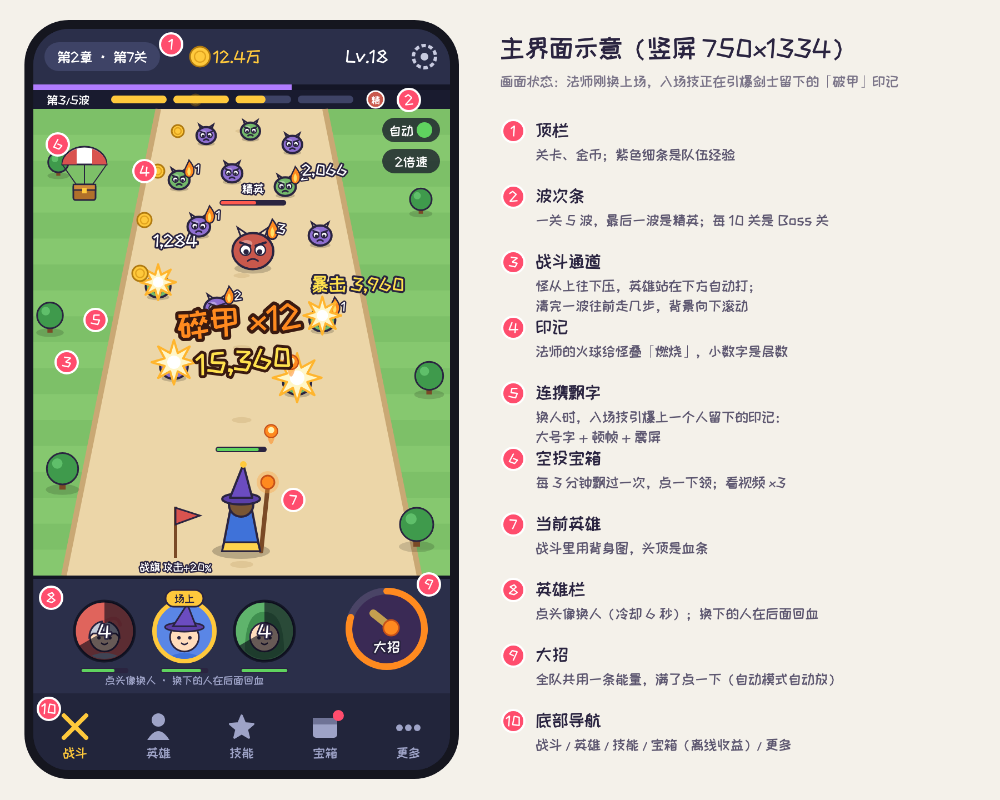
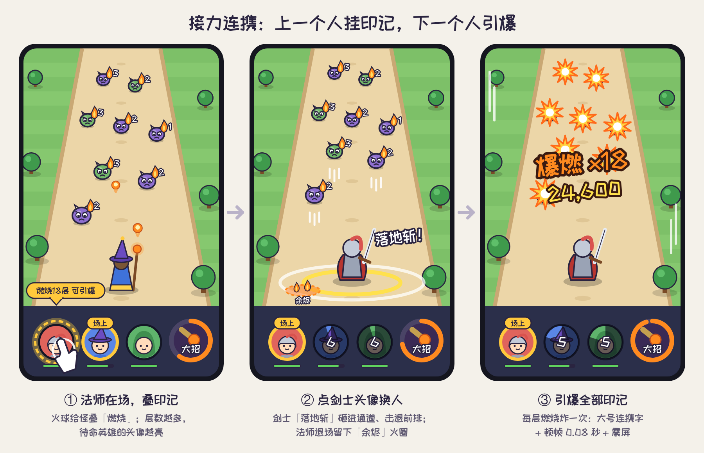

# 《Game Fight》游戏设计文档（GDD）v0.1

> 暂定名 · 抖音小游戏 · 竖屏 · 挂机割草 + 三人接力 · 纯广告变现
> v0.1 写于 2026-11-22。所有数值都是**初版占位**，开发时写进配置表，用数值模拟器调。
> 和《御兽山海》的关系：题材和玩法完全独立。技术框架（平台层、广告、存档、挂机、测试、模拟器）从那边搬过来，见第 13 节。

---

## 目录

1. 概述
2. 表现形式：主界面长什么样
3. 特色与差异点
4. 战斗系统
5. 英雄（MVP 3 个）
6. 成长系统
7. 关卡与敌人
8. 挂机与离线
9. 经济与节奏目标
10. 新手引导（前 10 分钟）
11. 广告
12. 高光录屏与分享
13. 技术方案
14. 美术需求
15. MVP 范围与开发顺序
16. 需要拍板的事

---

## 1. 概述

| 项 | 内容 |
|---|---|
| 一句话 | 一条通道，三个英雄轮流上场。放着不管就自动割草；想爽的时候点一下换人，把上一个人留下的印记一口气引爆。 |
| 平台 | 抖音小游戏（先），微信小游戏（以后） |
| 屏幕 | 竖屏 750×1334 设计稿，单手操作 |
| 单次时长 | 打开一次 2～5 分钟；一关 30～45 秒；Boss 战 30 秒限时 |
| 目标用户 | 在抖音上刷到割草、打怪、挂机视频的 18～40 岁轻度玩家 |
| 变现 | 激励视频为主，少量插屏；不做内购 |
| 三个卖点 | ① **三人接力**：换人时放入场技，引爆前一个人留下的印记（第 3、4 节）② **挂机能玩，手动更爽**：同一场战斗，不操作也能推，操作了伤害更高 ③ **高光自动录屏**：大连携、Boss 击杀自动剪成短视频，一键发抖音（第 12 节） |

**设计原则：**
- **打开就在打。** 没有开场剧情、没有选角色，进游戏的第一帧就是战斗。
- **10 秒内第一次升级，30 秒内学会换人，1 分钟打完第一关。**
- **玩家只需要做两件事：换人、放大招。** 其他全自动。
- **不操作不会输，只会慢一点。** 失败只会发生在玩家主动挑战 Boss 的时候。
- **广告是帮玩家占便宜，不是收过路费。**

---

## 2. 表现形式：主界面长什么样

### 2.1 选型：竖向通道

| | **A. 竖向通道（采用）** | B. 横向通道 |
|---|---|---|
| 样子 | 怪从屏幕上方成群往下压，英雄站在通道下方往上打 | 英雄在左、怪从右边来，战斗区只占屏幕中间一条 |
| 屏幕利用 | 战斗区约占 60% 屏幕，同屏 20～40 只怪 | 战斗区约占 35%，同屏 5～8 只怪 |
| 爽感 | 割草感强：一刀清一排、一箭穿一列、一招炸一片 | 偏一对一，像传统挂机游戏 |
| 技能形状 | 横扫一排 / 纵向贯穿 / 圆形范围 / 全屏，四种形状一眼能分清 | 基本只有"打前面" |
| 玩家熟悉度 | 抖音上竖屏割草游戏很多，看一眼就懂 | 老式挂机的样子 |
| 美术成本 | 英雄要多画一张背身图 | 一张侧身图就够 |

**画面形式用玩家熟悉的样子，差异放在玩法上（第 3 节）。** 玩家不用学"怎么看这个画面"，所有注意力都留给换人和连携。

### 2.2 主界面布局



| 区域 | 占屏高度 | 内容 |
|---|---|---|
| 顶栏 | 约 8% | 关卡（第 2 章 · 第 7 关）、金币、队伍等级、设置；下沿一条细的经验条 |
| 波次条 | 约 3% | 本关第几波，最后一个点是精英或 Boss |
| 战斗通道 | 约 62% | 见 2.3；右上角是「自动」「2 倍速」开关，左侧偶尔飘过空投宝箱 |
| 英雄栏 | 约 16% | 3 个头像：场上的那个有金边，待命的显示换人冷却和血量；右边是大招按钮，外圈是能量 |
| 底部导航 | 约 11% | 战斗 / 英雄 / 技能 / 宝箱 / 更多 |

### 2.3 通道里在发生什么

1. **一关 = 4 波小怪 + 第 5 波精英。** 每 10 关是 Boss 关（第 7 节）。
2. 小怪从通道顶端成群出现，往下走；走到英雄面前就停下来打英雄。
3. 英雄自动攻击最近的怪，技能冷却好了自动放。
4. **一波清完，英雄往前走几步，背景向下滚动，下一波出现。** 玩家能直接看到自己在往前推进。
5. 怪被打死：闪白 → 压扁弹飞 → 掉金币，金币自己飞进顶栏；经验光点直接吸进经验条。
6. 普通关打完自动进下一关。**Boss 关不会自动开打**，通道顶端出现「挑战 Boss」按钮，玩家点了才打（第 4.5 节）。
   - 这一条吸取了《御兽山海》的试玩反馈："打开首页就自动推关、然后莫名其妙输了"，体验很怪。这里普通关挂机怎么打都不会输，只有玩家主动点挑战的 Boss 才可能输。

### 2.4 美术怎么做：单张图 + 程序动画

角色和怪物都只画**单张图**，不画逐帧动画（用 ChatGPT 出图就能做）。动作全部由程序做：

| 动作 | 程序做法 |
|---|---|
| 待机 | 上下轻微起伏（呼吸） |
| 走路 | 左右轻摇 + 小跳 |
| 攻击 | 往前一冲再弹回，程序画出武器拖影 |
| 受击 | 闪白 + 往后弹 + 挤压变形 |
| 死亡 | 压扁 → 弹飞或碎成几块 → 淡出 |
| 入场技 | 英雄从屏幕外落下或冲进来，落地时冲击波 |
| 大招 | 英雄**正面立绘**从侧面滑入 0.6 秒（特写横幅），然后全屏特效 |

技能特效（火球、剑气、冰箭、爆炸、印记图标）由程序绘制（粒子、线条、光圈），不需要出图。

**打击感清单（M0 原型必须做到）：**
- 飘字：白色 = 普通，黄色加大 = 暴击，橙色特大 + 名字 = 连携引爆（「爆燃 ×18」）
- 顿帧：连携引爆、击杀精英 60～120 毫秒
- 震屏：大招、Boss 落地、连携 ≥ 15 层
- 金币飞进顶栏，数字跳动
- 升级：全屏金光一闪 +「叮」+ 飘字「Lv.12！」

**性能：** 同屏怪物上限 40 只；怪物、飘字、金币、粒子全部用对象池；低端安卓自动减少粒子。

---

## 3. 特色与差异点

### 3.1 同类游戏的三种做法

| 类型 | 典型样子 | 玩家常见的问题 |
|---|---|---|
| 放置挂机（点击升级类） | 战斗只占屏幕一小块，主要看数字往上涨 | 玩到后面只剩"点升级"，对战斗没有参与感 |
| 竖屏割草（每局三选一） | 每局从头开始，局内三选一拿技能 | 必须一直盯着操作，放下手机就停了；一局一局重复 |
| 放置卡牌（摆阵容自动打） | 摆好阵容，看战斗演出 | 战斗是"播片"，玩家只在战斗外面做决定 |

### 3.2 我们的定位：能挂机的割草，有操作的挂机

- 战斗像**割草游戏**：占满屏幕、怪多、一招炸一片。
- 成长像**挂机游戏**：一直在累积，下线也在涨，不用一局一局重来。
- 操作只有一个**换人**，但什么时候换、带哪三个人一起上，都有讲究。这一层在同类游戏里很少见，是我们的核心差异。

### 3.3 核心特色：三人接力



规则一句话：**上一个人挂印记，下一个人引爆。**

- 通道上同一时间只站一个英雄，另外两个在英雄栏待命。
- 每个英雄的攻击会给怪叠上**自己的印记**（剑士 = 破甲，法师 = 燃烧，射手 = 冰霜）。
- 点头像换人：换上来的英雄放一个**入场技**，把场上**别人的**印记全部引爆。叠得越多，炸得越狠。
- 换下去的英雄留下一个 5 秒的**退场效果**（战旗、火圈、冰面），然后在后面回血。

**为什么选它当核心：**

1. **挂机和手动都成立。** 挂机时 AI 按固定节奏换人，照样能推进；手动看准印记叠满再换，伤害更高，Boss 更好打。放着能玩，想玩的时候也有东西玩。
2. **"每个角色技能不一样"有了意义。** 区别不只是数值高低，而是谁挂什么印记、谁的入场技怎么引爆。少量角色就能组合出很多玩法：9 个英雄里选 3 个，有 84 种队伍。
3. **操作量只有一个按钮。** 符合"短平快"，单手、碎片时间都能玩。
4. **连携瞬间天生适合传播。** 一次引爆十几层、满屏爆炸 + 大字，正好是抖音短视频需要的画面（第 12 节）。
5. **开发成本低。** 印记就是"带层数的状态"，换人就是"切换当前单位 + 放一个技能"，逻辑简单，好单测。

### 3.4 其他特色

| 特色 | 内容 | 版本 |
|---|---|---|
| 高光自动录屏 | 大连携、Boss 击杀、破纪录伤害自动剪成 10 秒视频，结算页一键发抖音，视频带游戏入口 | MVP |
| 自动化也是奖励 | 自动换人、自动放大招、智能换人、2 倍速都是打出来的解锁，越玩越省心（6.4） | MVP |
| Boss 破绽 | Boss 蓄力时出现收缩圆环，点在绿区触发「破绽」：Boss 硬直、受到双倍伤害。复用《御兽山海》写好的拍符判定代码 | 1.1 |

### 3.5 我们**不做**什么（保持短平快）

- 不做抽卡：英雄按关卡解锁（第 16 节可以再定）。
- MVP 不做装备系统。
- 不做剧情和世界观设定，每章开头最多一句话。
- 不做联网对战。
- 不做每局三选一的肉鸽：成长是持续累积的，不会每局清零。

---

## 4. 战斗系统

### 4.1 基本规则

- 属性只有四个：**攻击、生命、攻速、暴击率**（暴击固定 ×2 伤害）。
- 敌人属性：生命、攻击、移动速度。
- 英雄自动攻击最近的怪；技能冷却好了自动放。
- 每个英雄血量独立。场上的英雄倒下时，自动换下一个上场（照常放入场技）；三个都倒下才算失败。
- 战斗逻辑以固定步长运行（每秒 30 次），和画面分开，方便单测和数值模拟（第 13 节）。

### 4.2 换人

| 规则 | 初版数值 |
|---|---|
| 点待命英雄的头像就换人 | — |
| 换人冷却（全队共用） | 6 秒 |
| 换上来的英雄立即放入场技 | 入场技不占技能冷却 |
| 换下去的英雄留下退场效果 | 持续 5 秒 |
| 换下去的英雄在后面回血 | 每秒回 4% 生命 |
| 印记多时，待命头像发光提示 | 场上别人的印记 ≥ 12 层 |

**自动换人（挂机）：** 只看两条规则：每 10 秒换一次；场上英雄生命 < 25% 时立刻换。**不看印记**，所以手动看准时机换人的伤害会更高（目标：高 40%～60%，待模拟）。第 2 章 Boss 之后可以解锁「智能换人」（6.4）。

### 4.3 印记与引爆

- 每只怪身上每种印记最多 5 层，8 秒不再叠就消失。
- 入场技引爆场上**所有别人的**印记，自己的印记不会被自己引爆。这样玩家才有理由换人。
- 引爆后印记清零。

| 印记 | 谁挂的 | 印记本身的效果 | 被引爆时 | 连携名 |
|---|---|---|---|---|
| 破甲 | 剑士 | 每层让这只怪受到的伤害 +4% | 每层造成入场英雄攻击 ×60% 的伤害，并击退 | 碎甲 |
| 燃烧 | 法师 | 每层每秒造成法师攻击 ×8% 的伤害 | 每层爆炸一次，对周围一小圈造成攻击 ×50% 的伤害 | 爆燃 |
| 冰霜 | 射手 | 每层减速 10%，叠满 5 层冻住 2 秒 | 碎冰：对这只怪造成攻击 ×120%/层 的伤害，冻住的怪必定暴击 | 碎冰 |

引爆时的表现：顿帧 80 毫秒 → 每层一个爆点依次炸开 → 大号飘字「爆燃 ×18 · 24,600」；≥ 15 层时加震屏。

**接力连段（1.1）：** 连续几次换人都引爆 ≥ 8 层，就形成连段 ×2、×3……，每段伤害 +10%，断了清零。先不进 MVP，看原型手感再决定。

### 4.4 大招

- 全队共用一条能量：打中怪、引爆印记都加能量。满了以后，大招按钮亮起，放的是**当前场上英雄**的大招。
- 放大招：英雄正面立绘特写横幅 0.6 秒 → 全屏特效 → 震屏。
- 自动模式下能量满了自动放（第 2 关解锁，6.4）。

### 4.5 失败与 Boss

- **普通关**：英雄全倒 → 回到上一关继续挂机，不扣任何东西，顶部提示"差一点！升级后再来"。下次复活后自动再推。
- **Boss 关**（每章第 10 关）：不自动开打。通道顶端出现「挑战 Boss」按钮；Boss 战限时 30 秒，超时或全倒算失败，回去继续挂机。
- 失败弹窗三个选项：**看视频复活**（三人满血、能量满，接着打）/ **去升级** / **继续挂机**。
- 同一个 Boss 连续失败 3 次，提示一个具体建议（程序根据差距生成）："攻击再升 5 级就够了"或"试试先用法师叠满燃烧再换人"。

---

## 5. 英雄（MVP 3 个）

每个英雄都有：普攻、2 个技能、印记、入场技、退场效果、大招。

### 5.1 剑士：近战 · 前排（开局就有）

| 项 | 内容 |
|---|---|
| 普攻 | 横斩，打面前一排（攻速 1.0 次/秒） |
| 技能 1 · 旋风斩 | 原地转 2 秒，打身边一圈（冷却 8 秒） |
| 技能 2 · 冲锋 | 向前冲一段再退回，撞飞路上的怪（冷却 10 秒） |
| 印记 | 破甲 |
| 入场技 · 落地斩 | 从天而降砸地，击退前排，引爆印记 |
| 退场效果 · 战旗 | 原地插一面旗，5 秒内下一个英雄攻击 +20% |
| 大招 · 剑气风暴 | 向前连续斩出 5 道剑气，每道贯穿整条通道 |

### 5.2 法师：范围 · 燃烧（新手引导第 25 秒加入）

| 项 | 内容 |
|---|---|
| 普攻 | 火球，命中后小范围溅射（攻速 0.8 次/秒） |
| 技能 1 · 火雨 | 通道中段下 3 秒火雨（冷却 9 秒） |
| 技能 2 · 炎墙 | 在通道上横着放一道火墙 5 秒，穿过的怪叠燃烧（冷却 12 秒） |
| 印记 | 燃烧 |
| 入场技 · 爆炎 | 引爆印记，再朝怪最多的地方扔一个大火球 |
| 退场效果 · 余烬 | 原地留下一圈火 5 秒，踩进来的怪叠燃烧 |
| 大招 · 陨石 | 3 颗陨石砸在怪最密的地方 |

### 5.3 射手：单体 · 穿透 · 控制（第 5 关通关加入）

| 项 | 内容 |
|---|---|
| 普攻 | 快速射箭，每第 3 箭穿透（攻速 1.6 次/秒） |
| 技能 1 · 多重箭 | 扇形射出 7 支箭（冷却 7 秒） |
| 技能 2 · 冰霜箭 | 一箭贯穿整列，叠 2 层冰霜（冷却 9 秒） |
| 印记 | 冰霜 |
| 入场技 · 贯穿箭 | 一箭打穿整条通道，引爆印记 |
| 退场效果 · 冰面 | 原地留下 5 秒冰面，怪走上去减速 50% |
| 大招 · 箭雨 | 全屏箭雨 3 秒 |

三个英雄覆盖了四种技能形状：横排（剑士）、纵列（射手）、圆形范围（法师）、全屏（大招）。

### 5.4 后续英雄（1.0 起，按章节解锁）

| 英雄 | 定位 | 印记 | 被引爆时 |
|---|---|---|---|
| 雷法师 | 闪电链 | 感电 | 闪电在带印记的怪之间连锁跳 |
| 召唤师 | 召唤小兵挡在前面 | 灵魂 | 怪死后变成我方小兵 |
| 刺客 | 高暴击，闪到后排 | 流血 | 按怪已损失的生命造成伤害 |
| 守护者 | 护盾、嘲讽 | 震荡 | 群体眩晕 1.5 秒 |
| 毒师 | 毒雾扩散 | 剧毒 | 毒传染给周围的怪 |
| 炮手 | 远程大范围 | 标靶 | 对标记的怪追加一轮炮击 |

新英雄是长线的主要内容：每加一个英雄，就多出一批队伍组合。

---

## 6. 成长系统

你说的"打怪拿经验和金币 → 到阶段升级、学技能"，拆成三条线：

| 资源 | 怎么来 | 用来干什么 | 玩家感受 |
|---|---|---|---|
| 经验 | 打怪掉 | 自动升级，不用操作 | 一直"叮叮叮"地变强 |
| 技能点 | 每 5 级给 1 点 | 学技能、升技能、点天赋 | 隔一阵子做一次选择 |
| 金币 | 打怪掉、宝箱 | 强化攻击、生命、攻速、暴击 | 随时都有东西可花 |

### 6.1 队伍等级

- 全队共用一个等级，打怪的经验都进这里。待命的英雄不会掉队。
- 每升 1 级：全队攻击、生命 +3%（初版）。
- 每 5 级给 1 技能点；第 10、20、30……级开一个新天赋格。
- 节奏目标：前 10 分钟约每 30～60 秒升一级。

### 6.2 技能树

- 每个英雄一棵小技能树：技能 1、技能 2、入场技、大招各 5 级 + 3 个天赋（每个 3 级）。
- 技能点全队共用，投给哪个英雄都行；**重置免费**，鼓励换着试。
- 天赋示例（每个都改变玩法，不只是加数值）：
  - 剑士「重甲」：破甲上限 5 层 → 8 层
  - 法师「蔓延」：燃烧会传染给旁边的怪
  - 射手「碎冰掉宝」：被碎冰打死的怪掉双倍金币

### 6.3 金币强化

- 每个英雄单独强化：攻击、生命（每级价格 ×1.07）。
- 全队强化：攻速、暴击率、金币加成（有上限）。
- 「英雄」页有「一键升级」：把金币按性价比自动花掉；金币够升级时，底部「英雄」按钮出红点。

### 6.4 自动化解锁

| 解锁 | 条件 |
|---|---|
| 自动换人（固定节奏） | 新手引导结束 |
| 自动放大招 | 第 2 关 |
| 2 倍速 | 第 1 章 Boss |
| 智能换人（印记叠够再换） | 第 2 章 Boss |
| 自动挑战 Boss（战力够了才挑） | 第 4 章 Boss |

前期先让玩家亲手做一遍，学会了再交给自动。

### 6.5 转生（1.1，长线）

- 打到第 6 章后可以「重新出发」：关卡、等级、金币强化清零，按最高关卡换「荣誉」。
- 荣誉买永久加成（全队攻击、金币、开局直接从第 N 关开始）。
- 转生是挂机游戏撑长线的标准做法，玩家第二遍能推得快很多。数值等模拟器跑完再定。

---

## 7. 关卡与敌人

- 1 章 = 10 关，第 10 关是 Boss。每章换一个场景（背景主色和怪物种类）。
- 普通关 4 波小怪 + 1 只精英，约 30～45 秒。
- MVP 做 6 章 60 关；1.0 做 10 章，加上转生。

**小怪（MVP 6 种，后面换皮加色复用）：**

| 种类 | 特点 | 让哪个英雄更好用 |
|---|---|---|
| 冲锋怪 | 快、脆，成群冲 | 剑士横扫 |
| 肉盾怪 | 慢、厚 | 剑士破甲、射手碎冰 |
| 远程怪 | 停在后面射 | 射手贯穿 |
| 分裂怪 | 死后分成两只小的 | 法师范围 |
| 飞行怪 | 不吃地面效果（火墙、冰面） | 射手 |
| 盾牌怪 | 正面减伤 70%，被击退时破盾 | 剑士落地斩 |

**精英：** 小怪放大 1.5 倍 + 换色 + 带一个词缀（加速、回血、召唤），不用单独出图。

**Boss（6 个）：** 每个一个机制，让换人有用：
- 第 1 章：大肉盾，什么都不会。教玩家"Boss 要挑战"。
- 第 2 章：召唤小怪。需要法师清场。
- 第 3 章：护盾 5 秒刷新一次，只有引爆能打穿。教连携。
- 第 4～6 章：冲锋、分身、狂暴，后面再细化。

**敌人成长（占位）：** 每关小怪生命 ×1.13，Boss 生命 = 当关一波小怪总生命 × 10，金币掉落 ×1.11。用模拟器调。

---

## 8. 挂机与离线

- **在线：** 实际打多少拿多少。
- **离线：** 按最高通关关卡的每分钟收益 × 离线时长 × 60%，最多攒 8 小时。直接复用《御兽山海》`idle.ts` 的规则，包括防止改手机时间刷收益。
- **回来时：** 弹窗「你不在的 3 小时 12 分，队伍打倒了 4,812 只怪」+ 金币和经验数字滚动；看视频 ×2。
- **空投宝箱：** 在线时每 3 分钟从通道上飘过一个，点一下才领；看视频 ×3。也给玩家一个看屏幕的理由。

---

## 9. 经济与节奏目标

货币只有：金币、经验、技能点、荣誉（1.1）。不做付费货币。

**节奏目标（待模拟器验证）：**

| 时间点 | 目标进度 |
|---|---|
| 第 1 分钟 | 打完第 1 关，Lv.3，学会换人 |
| 第 10 分钟 | 打第 1 章 Boss（第 10 关），Lv.12 左右 |
| 第 15～20 分钟 | **第一次推不动**（约第 15 关），引导去强化和学技能 |
| 第 1 天 | 第 3 章 |
| 第 3 天 | 第 5 章 |
| 第 7 天 | 打完第 6 章，解锁转生 |
| 第 30 天 | 转生 5～10 次，解锁 6 个以上英雄 |

- 不看广告也能稳定推进，大约慢 20%（同《御兽山海》的原则）。
- 广告奖励按"当前关卡的挂机收益 × 时长"计算，后期看广告也一样值。

---

## 10. 新手引导（前 10 分钟）

| 时间 | 发生什么 | 教会什么 |
|---|---|---|
| 0 秒 | 打开就在打：剑士自动砍小怪，没有任何弹窗 | 什么都不用做 |
| 约 10 秒 | 第一次升级，全屏金光 | 打怪会变强 |
| 约 25 秒 | 法师从屏幕边跑进英雄栏；场上破甲印记已经叠了十几层，手指提示点法师头像 | 换人 |
| 约 30 秒 | 法师「爆炎」引爆破甲：满屏爆炸 + 大字「碎甲 ×14」 | **接力 = 爽** |
| 约 45 秒 | 能量满了，手指提示点大招 | 大招 |
| 约 1 分钟 | 第 1 关精英出现，打完进第 2 关 | 一关的结构 |
| 约 2 分钟 | 金币够了，手指提示「一键升级」 | 金币强化 |
| 约 3 分钟 | 第 5 关通关，射手加入 | 第三个英雄 |
| 约 5 分钟 | 第一次拿到技能点，引导点法师「炎墙」 | 技能树 |
| 约 10 分钟 | 第 1 章 Boss，提示「挑战 Boss」 | Boss 规则、失败不扣东西 |

---

## 11. 广告

| 位置 | 类型 | 奖励 | 每日上限 | 版本 |
|---|---|---|---|---|
| 离线收益翻倍 | 激励 | ×2（每天第一次 ×3） | 每次回来 1 次 | MVP |
| 失败复活 | 激励 | 三人满血、能量满，接着打 | 5 | MVP |
| 空投宝箱 | 激励 | ×3 | 6 | MVP |
| 狂暴 | 激励 | 3 分钟内攻速 ×2、金币 ×2 | 4 | MVP |
| 关卡结算 | 插屏 | — | 间隔 ≥ 3 分钟，前 10 分钟不出，每天 ≤ 6 | MVP |
| 挂机加速 | 激励 | 立刻得 2 小时离线收益 | 3 | 1.0 |

- 直接复用《御兽山海》的 `AdService`：每日上限、版本开放、插屏间隔、新手保护、无填充补偿、埋点都已经写好了。
- 激励按钮写清楚"看视频得 XX"，奖励立即到账，有动画。
- 目标：看广告的玩家每天 6～10 次激励。

---

## 12. 高光录屏与分享

- 战斗时用抖音小游戏的游戏录屏接口在后台录，出现高光时刻就剪下前后约 10 秒。
- 高光时刻：一次引爆 ≥ 20 层、Boss 击杀、首次通关一章、单次伤害破个人纪录。
- 结算页出现「发抖音」按钮：视频自动带话题，带小游戏入口，别人刷到可以直接点进来玩。
- 能不能给"分享奖励"、录屏和挂载的具体接口，**以抖音开放平台当时的规则和文档为准**（平台对诱导分享有限制）。

---

## 13. 技术方案

和《御兽山海》一样：**Cocos Creator 3.8 + TypeScript**，抖音小游戏，竖屏 750×1334。分层规则也一样：

- `core/`：纯游戏逻辑，不 `import 'cc'`、不用 `tt`，能在 Node 里单测。**战斗也放在这里**，固定步长运行，画面只负责"演出来"。离线收益和数值模拟器也用同一套公式。
- `platform/`：抖音接口、浏览器调试实现、广告、埋点。
- `app/`：组装 core 和 platform，负责存档和前后台切换。
- `view/`：Cocos 界面和战斗演出（对象池、飘字、粒子、顿帧、震屏）。

**从《御兽山海》搬过来的部分：**

| 模块 | 改动 |
|---|---|
| `platform/`（抖音实现、浏览器实现、平台接口） | 基本不改 |
| `AdService`、`Analytics` | 只改广告位配置 |
| `app/App.ts`（存档、版本迁移、前后台） | 改成新的 core 类型 |
| `core/rng.ts` | 不改 |
| `core/systems/idle.ts` 的离线规则 | 改收益公式 |
| 配置表校验、vitest 测试结构 | 照搬 |
| `tools/sim` 数值模拟器 | 换成新模型 |
| `tools/art` 美术导入、字体裁剪 | 照搬 |
| `RevealSession` 拍符判定 | Boss 破绽（1.1）用 |

**新写的部分：** 战斗模拟（单位、技能、印记、换人、波次）、战斗演出、英雄与技能配置表、技能树、录屏分享。

---

## 14. 美术需求（MVP）

| 类别 | 数量 | 说明 |
|---|---|---|
| 英雄正面立绘 | 3 | 用在英雄栏头像、英雄页、大招特写 |
| 英雄背身图 | 3 | 战斗里用，和正面是同一个角色 |
| 小怪 | 6 | 正面，朝下走向玩家；精英用小怪放大 + 换色 |
| Boss | 6 | 正面，大尺寸 |
| 通道背景 | 6 | 每章一张，竖向，能上下无缝拼接 |
| UI | 一套 | 按钮、头像框、图标、宝箱 |
| 特效 | — | 程序绘制，不用出图 |

一共约 30 张图。出图流程和《御兽山海》一样：ChatGPT 出图 → 传到 `art/inbox/` → 脚本自动抠图、裁边、压缩。具体的统一风格提示词等题材定了再写（第 16 节）。

---

## 15. MVP 范围与开发顺序

| 阶段 | 内容 | 验证什么 |
|---|---|---|
| **M0 手感原型** | 通道 + 剑士 + 法师 + 3 种小怪 + 换人引爆 + 飘字/顿帧/金币。灰盒画面，浏览器里能玩 | **打起来爽不爽、换人引爆有没有"啊哈"的感觉**。找 5 个人试玩 3 分钟，看他们会不会主动去点换人 |
| M1 核心循环 | 3 个英雄、大招、印记、队伍等级、技能树、金币强化、第 1～3 章、Boss | 前 30 分钟的成长节奏 |
| M2 可上线版 | 离线挂机、广告、新手引导、存档、录屏分享、6 章 60 关、正式美术，提审 | 留存和广告数据 |
| M3（1.1） | 转生、新英雄、Boss 破绽、接力连段 | 长线留存 |

**M0 是最重要的一步。** 这类游戏的成败主要看手感，先用最便宜的方式确认换人引爆真的好玩，再往上加系统。

---

## 16. 需要拍板的事

1. **题材和画风。** 玩法和题材无关，换题材只改名字和美术。
   - A. 西幻 Q 版（剑士、法师、射手，玩家一看就懂职业）——**推荐**，最直给
   - B. 东方武侠 / 仙侠 Q 版（剑客、符师、弓手）
   - C. 其他
2. **游戏名。**
3. **英雄怎么获得。** 推荐按关卡解锁（短平快，不需要做抽卡和概率公示）；如果想要抽卡的广告位，可以 1.0 之后再加。

---

## 附：示意图怎么改

两张示意图的源文件是 `docs/images/src/mockups.html`，用浏览器直接打开就能看。改完后导出 PNG：

```bash
npm i -D playwright && npx playwright install chromium   # 第一次
node tools/render-mockups.cjs                              # 用系统中文字体
node tools/render-mockups.cjs node_modules/@fontsource/zcool-kuaile/400.css   # 用站酷快乐体
```
